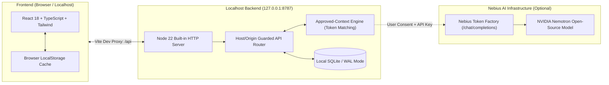

# Somnia 🌙
> **Privacy-First Personal AI & Cognitive Reflection Engine**  
> *Built for the Nebius × NVIDIA Global AI Hackathon (Personal AI Track)*

[](LICENSE)
[](https://nodejs.org/)
[](https://vitejs.dev/)
[](https://build.nvidia.com/)
[](https://tokenfactory.nebius.com/)

---

## 💡 What is Somnia?

**Somnia** is a local-first, privacy-governed personal reflection and planning assistant. Unlike mainstream AI chat apps that treat your personal data as training fuel or cloud hostage, Somnia keeps your life, thoughts, and decisions under **your absolute ownership**:

1. **User-Governed Memory CRUD:** You have complete control over what the AI remembers. Memories are never automatically extracted from conversations without your review; you create, approve, edit, archive, and delete them.
2. **Privacy-Preserving Context Injection:** When external AI is enabled, Somnia lexically retrieves only **user-approved** memories relevant to your prompt. Archived records and private open loops never leave your machine.
3. **Cognitive Sleep Cycle Review:** A deterministic background review that identifies stale approved memories (older than 180 days) for human reflection and decluttering.
4. **Decision Journal:** Record critical decisions, reasoning, context, and expected outcomes, with post-hoc outcome tracking to refine your mental models.
5. **NVIDIA Nemotron via Nebius Token Factory:** Integrates state-of-the-art open-source `nvidia/nemotron-3-super-120b-a12b` inference through Nebius Token Factory's high-speed API.
6. **Zero-Cost Local Fallback (Demo Mode):** Works completely offline with simulated canned responses if no API credentials are provided—meaning zero budget lock-in and zero vendor lock-in.

---

## 🏛️ Architecture



---

## 🚀 Quick Start (Run in Under 2 Minutes)

### Prerequisites
* **Node.js 22.13+** (uses Node's native `node:sqlite` module)
* **npm 10+**

### 1. Clone & Install
```bash
git clone https://github.com/DnyaneshwariF18/somniaa.git
cd somniaa/project
npm install
```

### 2. Configure Environment (Optional — Works 100% Offline by Default!)
Copy the example environment file:
```bash
cp .env.example .env
```

If you have Nebius Token Factory promotional credits:
```ini
SOMNIA_AI_BASE_URL=https://api.tokenfactory.nebius.com/v1/
SOMNIA_AI_API_KEY=your_nebius_api_key_here
SOMNIA_AI_MODEL=nvidia/nemotron-3-super-120b-a12b
```
*(If left blank, Somnia safely runs in local **Demo Mode** with simulated keyword replies at ₹0 cost).*

### 3. Launch Development Environment
```bash
npm run dev
```
This automatically starts the local backend, runs a health check, and spins up the Vite frontend at `http://localhost:5173`.

---

## 🧪 Testing & Verification

Somnia features a comprehensive mock-first test suite ensuring that running tests **never incurs cloud costs**:

| Command | Purpose | Network Cost |
|---|---|:---:|
| `npm run test:backend` | Executes full backend integration suite (Persistence, AI context isolation, Sleep Cycle idempotency, Memory CRUD) | **₹0 (Offline Mock)** |
| `npm run typecheck` | Validates TypeScript types across the entire application | **₹0** |
| `npm run build` | Produces production Vite client build | **₹0** |
| `npm run lint` | ESLint static code verification | **₹0** |
| `npm run test:live` | Explicit opt-in integration smoke test for Nebius Token Factory | **Manual Opt-in Only** |

---

## 🛡️ Privacy & Safety Design

* **No Unsanctioned Data Leakage:** The backend accepts connections only from `127.0.0.1` and `localhost`.
* **Zero Secret Leakage:** Provider API keys remain strictly in server-side environment variables and are never transmitted to the browser or logged.
* **Granular Consent:** Even when an API key is configured, external requests are only dispatched when the user has toggled AI sharing **ON** in Settings & Privacy.
* **Archived Isolation:** Only memories explicitly marked as `approved` can be retrieved into the prompt context; archived or unreviewed memories are excluded by design.

---

## 📄 License

This project is licensed under the [MIT License](LICENSE).

